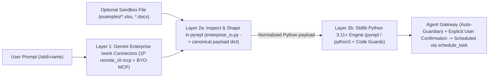

# Architecture of `gemini-agent-plugins`

This repository implements a two-layer architecture for **Gemini Enterprise (`/work`)**, combining Google's built-in `/work` data connectors and Agent Gateway (`Auto-Guardian`) with portable, deterministic Python computation packages.

## 1. Two-Layer `/work` Architecture & `pyrepl` Payload Normalization

Every plugin separates **connector acquisition** (Layer 1) from **deterministic domain math** (Layer 2) inside `.gemini-plugin/plugin.json` (validated against [`shared/schema/plugin.schema.json`](shared/schema/plugin.schema.json)):

1. **Primary — Live `/work` Enterprise Connectors (`managed_1p` + `byo_mcp`):** Each skill first invokes Gemini Enterprise's authorized 1P connectors (`BigQuery`, `Salesforce`, `ServiceNow`, `Jira`, `Confluence`, `GitHub`, `Slack`, `Microsoft 365`, `Google Workspace` via `remote_cli mcp`) or customer Bring-Your-Own MCP (`BYO-MCP`) servers discovered dynamically with `remote_cli mcp <connector> list-tools`.
2. **Inspect & Shape Custom Exports in `pyrepl`:** Before running analytics on real customer exports or live API payloads, [`shared/scripts/enterprise_io.py`](shared/scripts/enterprise_io.py) lets the agent inspect worksheet tabs (`read_xlsx_workbook`), Word tables/paragraphs (`read_docx`), CSV/TSV (`read_csv_tsv`), and JSON/JSONL (`read_json_or_jsonl`) directly inside `pyrepl` RAM. Mismatched headers or custom tabs normalize in 5-10 lines of Python into canonical `payload` dicts (calling `ask_question` only when source columns are genuinely ambiguous), while engines fail closed if non-empty tables miss required fields.
3. **Optional Zero-Connector Sandbox (`examples/`):** Local `.xlsx`, `.docx`, `.csv`, `.tsv`, `.json`, and `.jsonl` attachments under [`examples/`](examples/README.md) let workshops and evaluations verify all 60 Python engines before enterprise connectors are provisioned.

## 2. Typed Tenant Configuration & Day-1 Baselines

Prompting an agent without thresholds causes arbitrary risk ratings. Conversely, hardcoding a single customer's rules breaks portability across organizations.

- Every plugin exposes a strict Draft 2020-12 JSON Schema at `.gemini-plugin/config.schema.json` with `"org_configured": { "default": false }` and safe numeric bounds for organization thresholds.
- Six Day-1 starter rubrics live under [`shared/baselines/`](shared/baselines/):
  - [`commercial-contract-baseline.md`](shared/baselines/commercial-contract-baseline.md)
  - [`finance-materiality-baseline.md`](shared/baselines/finance-materiality-baseline.md)
  - [`deal-desk-approval-baseline.md`](shared/baselines/deal-desk-approval-baseline.md)
  - [`itsm-sla-severity-baseline.md`](shared/baselines/itsm-sla-severity-baseline.md)
  - [`hr-hiring-comp-baseline.md`](shared/baselines/hr-hiring-comp-baseline.md)
  - [`fsi-credit-kyc-baseline.md`](shared/baselines/fsi-credit-kyc-baseline.md)
- When `org_configured` is `false`, every computation engine automatically emits:
  `[EVALUATED AGAINST STANDARD BASELINE — BIND ORG CONFIG TO CUSTOMIZE]`
- Running `tools/package.py --org-config <tenant.json>` validates tenant threshold overrides against each plugin's `config.schema.json`, injects custom config into `references/config.json` with `"org_configured": true`, stamps clean tenant-specific `.zip` archives, and suppresses the baseline banner.

## 3. Persistent Python RAM Computation (`pyrepl` + CLI Parity)

LLMs should synthesize, inspect source structures, and explain decisions—never perform multi-currency arithmetic, aging buckets, BOM explosions, cohort retention, or cumulative beneficial-ownership graph traversals inside token prediction.

- Every one of the 60 workflow skills executes a dedicated stdlib-first Python 3.11+ engine exporting `load_config`, `load_payload`, `analyze`, `render_markdown`, and an `argparse` `main` entrypoint (`--input`, `--config`, `--format json|markdown`, `--output`).
- Inside Gemini Enterprise (`/work`), the agent resolves the mounted skill directory dynamically under `/workspace/skills/` inside persistent `pyrepl` RAM for fast single-pass evaluation, falling back cleanly to `python3 "$SKILL_DIR/scripts/<module>.py"` when executed outside `pyrepl`.

## 4. Enterprise API & Analytical Trap Defenses

Enterprise SaaS APIs fail in predictable ways that silently corrupt LLM conclusions. Nine shared guides under [`shared/traps/`](shared/traps/) are materialized into every packaged skill and bundle:

| Trap Guide | Core Failure Mode Prevented |
| :--- | :--- |
| [`absent-is-not-zero.md`](shared/traps/absent-is-not-zero.md) | Treating truncated pagination, `top-N` cutoffs, unpolled terminals, or missing records as `$0` / clean compliance |
| [`chain-denominator-seams.md`](shared/traps/chain-denominator-seams.md) | Joining mismatched fiscal calendars, promo-vs-baseline durations, or pre-FX vs post-FX denominators |
| [`untrusted-content-and-pii.md`](shared/traps/untrusted-content-and-pii.md) | Following attacker instructions embedded inside external emails/tickets/catalog copy, wire-change fraud, and raw SSN/PHI echoing |
| [`google-workspace-traps.md`](shared/traps/google-workspace-traps.md) | Missing Shared Drive query flags, ignoring tabbed Google Docs tabs, or reading formatted Sheets strings instead of `UNFORMATTED_VALUE` |
| [`sharepoint-onedrive-kql-traps.md`](shared/traps/sharepoint-onedrive-kql-traps.md) | Unscoped site searches, broken SharePoint KQL syntax, and document-library pagination ceilings |
| [`servicenow-jira-itsm-traps.md`](shared/traps/servicenow-jira-itsm-traps.md) | Mixing numeric state enums vs `display_value`, broken `sys_id` joins, and wall-clock vs business-elapsed SLA timers |
| [`salesforce-crm-soql-traps.md`](shared/traps/salesforce-crm-soql-traps.md) | Confusing `StageName` probability vs `ForecastCategory`, ignoring `DatedConversionRate`, and polymorphic `WhoId`/`WhatId` lookups |
| [`bigquery-sap-erp-traps.md`](shared/traps/bigquery-sap-erp-traps.md) | Unfiltered BigQuery full-table scans, SAP `TCURR` inverted rates, `TCURX` 0-decimal JPY/KRW shifts, `SHKZG` sign inversions, and `GR/IR` timing |
| [`workday-hris-traps.md`](shared/traps/workday-hris-traps.md) | Counting future/historical effective-dated rows, double-counting Contingent Workers (`CWK`) in FTE totals, and small-cell `n < 5` re-identification |

## 5. Agent Gateway (`Auto-Guardian`) & Code-Enforced Guardrails

Rather than shipping custom policy files that runtimes cannot enforce, each `plugin.json` (`write_governance`) pairs `/work` runtime protections with code-enforced data invariants:
- `gateway_approval_actions`: concrete external mutations (ERP invoice releases via customer `BYO-MCP`, Jira/ServiceNow ticket updates, customer Gmail/Outlook sends, GitHub PR approvals) gated by **Gemini Enterprise Agent Gateway (`Auto-Guardian`)** and explicit user confirmation in chat.
- `python_code_guardrails`: deterministic invariants enforced inside `scripts/*.py` before JSON or Markdown emission (such as `TCURX` scaling, `n < 5` cohort suppression in HR compensation reports, and prompt-injection quarantine flags on contract/listing inputs).

## 6. Conversational Scheduling (`schedule_task`)

Each plugin declares a `scheduled_routine` object in `.gemini-plugin/plugin.json` matching Gemini Enterprise (`/work`)'s native `schedule_task` contract:
- `name` and human-readable `title`.
- Standard 5-field `cron_expression` paired with `time_zone` (`"UTC"`).
- Self-contained `instruction` prompt executed only when a user explicitly asks to schedule recurring monitoring in chat.

## 7. Dual Packaging & Clean-Room CI Validation

[`tools/package.py`](tools/package.py) preserves a single source of truth while generating two ready-to-upload formats:
- `dist/bundles/<plugin-id>.zip` (20 archives): synthesizes a root router `SKILL.md` documenting authorized connectors, `pyrepl` payload shaping, and skill scripts, rewrites relative workflow links into `references/workflows/<skill-id>.md`, and bundles all 3 scripts, `config.json`, traps, and baselines.
- `dist/skills/<skill-id>.zip` (60 archives): packages each individual skill verbatim with only the traps and baselines declared by its parent plugin.

[`tools/validate_repo.py`](tools/validate_repo.py) and `EVAL.yaml` enforce JSON Schema compliance (`plugin.schema.json`, `config.schema.json`, `write_governance`, and `scheduled_routine`), 5-field cron validity, exact relative code/Markdown link checks across all 140 `SKILL.md` contexts (60 source + 60 skill zips + 20 bundle zips), AST non-stub enforcement, deterministic `dist/manifest.json` and `docs/catalog_data.js` zero-drift checks, and clean-room hygiene across source files, packaged `.zip` internals, and `git log`.
