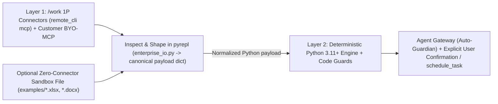

# Gemini Agent Plugins

[](LICENSE)
[](.gemini-agent/catalog.json)
[](.gemini-agent/catalog.json)
[](pyproject.toml)

Production-grade department skill bundles, deterministic Python 3.11+ computation engines, idiomatic `pyrepl` header inspection and payload normalization, enterprise API trap guides, typed organization configuration schemas, and Agent Gateway (`Auto-Guardian`) governance built for **Gemini Enterprise (`/work`)**.

Browse all 20 plugins, 60 verified sample outputs, interactive `i` playbooks, and 90-run ablation scorecards in the zero-server [**Interactive Catalog & Benchmark Explorer (`docs/index.html`)**](docs/index.html) (opens offline via `file://` or GitHub Pages).

Every plugin solves real enterprise failure modes instead of wrapping thin prompts:
- **Two-Layer `/work` Architecture (Connectors + Python Engines):** **Layer 1** uses Gemini Enterprise's built-in 1P connectors (`BigQuery`, `Salesforce`, `ServiceNow`, `Jira`, `Confluence`, `GitHub`, `Slack`, `Microsoft 365`, `Google Workspace` via `remote_cli mcp`) and customer `BYO-MCP` servers to query live records or SharePoint/Drive exports. **Layer 2** inspects real headers/tabs directly in persistent `pyrepl` RAM, normalizes custom fields in Python, runs pure stdlib Python 3.11+ computation (or `python3` CLI), and enforces code-level privacy and injection guardrails.
- **Zero-Dependency Ingestion & Python Shaping:** [`shared/scripts/enterprise_io.py`](shared/scripts/enterprise_io.py) reads `.xlsx`, `.docx`, `.csv`, `.tsv`, `.json`, and `.jsonl` files using strictly the Python standard library. In `/work`, agents inspect real customer tabs, headers, and JSON keys first in `pyrepl`, shape mismatched fields into canonical `payload` dicts in 5-10 lines of Python (asking only when columns are genuinely ambiguous), and pass `payload` straight to `analyze(payload, config=...)`.
- **Zero-Day Starter Baselines:** Every plugin ships `org_configured: false` in `references/config.json` paired with Day-1 industry baselines in `shared/baselines/` and stamps outputs with `[EVALUATED AGAINST STANDARD BASELINE — BIND ORG CONFIG TO CUSTOMIZE]` until tenant thresholds are bound via `tools/package.py --org-config`.
- **Enterprise API Trap Defenses:** Nine shared trap guides under `shared/traps/` encode pagination limits (`absent-is-not-zero.md`), cross-system denominator normalization (`chain-denominator-seams.md`), indirect prompt injection defense (`untrusted-content-and-pii.md`), and SAP/Workday/Salesforce/ServiceNow/SharePoint/Workspace data-shape quirks.



## Benchmark Highlights

Evaluated across **90 live, skill-registry-isolated runs** over **130 synthetic `Apex Global` artifacts** (`60,089` spreadsheet rows across `12` `.xlsx` workbooks, `219` pages across `8` `.docx`/`.pdf` compendiums, and live Workspace/Jira/Wiki connectors), equipping an agent with deterministic Python engines outperformed both raw unguided prompting and prose-only playbooks (see full analysis in [`benchmarks/EVALUATION.md`](benchmarks/EVALUATION.md)).

| Tier & Model | Evaluation Arm | `n` | Composite Pass | Factuality Pass (`WF >= 0.80`) | Perfect `WF = 1.0` | Forbidden Violations | Avg Latency |
| :--- | :--- | ---: | ---: | ---: | ---: | ---: | ---: |
| `Standard Fast Tier (gemini-3.8-flash)` | `Base Agent (No Plugin)` | `20` | `13 / 20` (`65.0%`) | `11 / 20` (`55.0%`) | `11 / 20` | `1` (`PE-08` PII) | `276.7s` |
| `Standard Fast Tier (gemini-3.8-flash)` | `gemini-agent-plugins (Playbook + Deterministic Python Engine)` | `20` | **`17 / 20` (`85.0%`)** | **`17 / 20` (`85.0%`)** | **`16 / 20`** | **`0`** | `309.1s` |
| `Standard Fast Tier (gemini-3.8-flash)` | `Prose-Only Playbook Baseline (Markdown Checklists Only)` | `20` | `9 / 20` (`45.0%`) | `8 / 20` (`40.0%`) | `7 / 20` | `1` (`PE-08` PII) | `302.8s` |
| `Frontier Reasoning Tier (gemini-4-argon)` | `Base Agent (No Plugin)` | `6` | `2 / 6` (`33.3%`) | `3 / 6` (`50.0%`) | `3 / 6` | `0` | `453.7s` |
| `Frontier Reasoning Tier (gemini-4-argon)` | `gemini-agent-plugins (Playbook + Deterministic Python Engine)` | `6` | **`3 / 6` (`50.0%`)** | **`4 / 6` (`66.7%`)** | `3 / 6` | `0` | `446.5s` |
| `Model Armor + DLP Governance (gemini-3.8-flash)` | `Base Agent (No Plugin)` | `6` | `3 / 6` (`50.0%`) | `3 / 6` (`50.0%`) | `3 / 6` | `0` | `340.9s` |
| `Model Armor + DLP Governance (gemini-3.8-flash)` | `gemini-agent-plugins (Playbook + Deterministic Python Engine)` | `6` | **`4 / 6` (`66.7%`)** | **`4 / 6` (`66.7%`)** | **`4 / 6`** | `0` | **`304.7s`** |

Three practitioner takeaways emerged across the 90 runs:
1. **Horizontal vs. Regulated Verticals**: `gemini-agent-plugins` scored **`8 / 8` (`100.0%`) Composite and `1.000` Factuality** on shared horizontal workflows (`PE-01`–`PE-05`, `PE-10`, `PE-11`, `PE-14`) and more than doubled high-factuality pass rates across the `12` enterprise-ops and regulated verticals (**`33.3% -> 75.0%`**, **`+41.7 pp`**, McNemar exact `p = 0.0117` vs `Prose-Only Playbook Baseline`).
2. **Code-Level Privacy & Injection Gates Beat Prompt Reminders**: On `PE-08` (`4,196`-row HR Census), both `Base Agent` and `Prose-Only Baseline` leaked individual `$187,920` USD salary details for `EMP-APX-007` in narrative text, whereas `comp_band_analyzer.py` enforced structural `n < 5` cohort suppression with `0` violations (`0.993` composite).
3. **Deterministic Engines Beat Prose Checklist Bloat**: Dense markdown-only checklists triggered `420s` turn timeouts (`PE-03`, `PE-05`, `PE-14`), whereas concise JSON emission from Python scripts cut latency even under live `Model Armor + DLP Governance` (`304.7s` vs `340.9s`). During initial `Frontier Reasoning Tier (gemini-4-argon)` testing, trajectories revealed `gemini-4-argon` autonomously searching shared registries on `5/12` baseline runs before strict empty-registry isolation was enforced.

## Start in 2 Minutes — By Persona

Pick your enterprise role below to download a single `.zip` skill archive, attach a ready-made starter artifact from [`examples/`](examples/README.md), and follow the persona playbook.

| Persona | Primary Workflow | Download `.zip` | Try Sample File | Read Guide |
| :--- | :--- | :--- | :--- | :--- |
| **AP Controller / FP&A** | 3-Way Match (`TCURX`/`SHKZG`), P&L Variance & AR Credits | [`finance-variance-recon.zip`](dist/bundles/finance-variance-recon.zip) | [`Apex_Finance_3Way_PnL_and_AR_Sample.xlsx`](examples/finance-variance-recon/Apex_Finance_3Way_PnL_and_AR_Sample.xlsx) | [`ap-three-way-match`](plugins/finance-variance-recon/skills/ap-three-way-match/README.md) |
| **Commercial Counsel** | `1/3/9` MSA/DPA Redlining, Obligation Traps & Prompt Injection | [`legal-contract-desk.zip`](dist/bundles/legal-contract-desk.zip) | [`Apex_MSA_Obligations_and_Compliance_Sample.docx`](examples/legal-contract-desk/Apex_MSA_Obligations_and_Compliance_Sample.docx) | [`contract-playbook-redliner`](plugins/legal-contract-desk/skills/contract-playbook-redliner/README.md) |
| **Credit / AML Officer** | Multi-Hop UBO (`10%` EDD), Smurfing & Covenant Stress | [`fsi-credit-kyc-claims.zip`](dist/bundles/fsi-credit-kyc-claims.zip) | [`Apex_FSI_Credit_AML_and_Claims_Sample.xlsx`](examples/fsi-credit-kyc-claims/Apex_FSI_Credit_AML_and_Claims_Sample.xlsx) | [`kyc-aml-screening-dossier`](plugins/fsi-credit-kyc-claims/skills/kyc-aml-screening-dossier/README.md) |
| **Total Rewards / HRBP** | Census Deduplication, Compa-Ratio & `n < 5` Privacy Gate | [`people-ops-talent-hub.zip`](dist/bundles/people-ops-talent-hub.zip) | [`Apex_Workforce_Hiring_and_Onboarding_Sample.xlsx`](examples/people-ops-talent-hub/Apex_Workforce_Hiring_and_Onboarding_Sample.xlsx) | [`workforce-attrition-comp-audit`](plugins/people-ops-talent-hub/skills/workforce-attrition-comp-audit/README.md) |
| **ITSM / CAB Chair** | Freeze-Window CAB Risk Scoring & P1 Incident Clustering | [`itsm-command-center.zip`](dist/bundles/itsm-command-center.zip) | [`Apex_ITSM_Incidents_CAB_and_KCS_Sample.xlsx`](examples/itsm-command-center/Apex_ITSM_Incidents_CAB_and_KCS_Sample.xlsx) | [`change-risk-cab-review`](plugins/itsm-command-center/skills/change-risk-cab-review/README.md) |
| **Deal Desk / RevOps** | Discount Tier Routing (`>35%` CFO), Commit Slippage & RFP | [`deal-desk-rfp-engine.zip`](dist/bundles/deal-desk-rfp-engine.zip) | [`Apex_Deal_Desk_Pipeline_and_RFP_Sample.xlsx`](examples/deal-desk-rfp-engine/Apex_Deal_Desk_Pipeline_and_RFP_Sample.xlsx) | [`deal-desk-quote-guard`](plugins/deal-desk-rfp-engine/skills/deal-desk-quote-guard/README.md) |
| **Sourcing / Supply Chain** | `+25%` Tariff Landed Cost, Compound BOM Scrap & GR/IR | [`erp-procure-to-pay.zip`](dist/bundles/erp-procure-to-pay.zip) | [`Apex_Supply_Chain_BOM_RFx_and_GRIR_Sample.xlsx`](examples/erp-procure-to-pay/Apex_Supply_Chain_BOM_RFx_and_GRIR_Sample.xlsx) | [`supplier-rfx-tariff-modeler`](plugins/erp-procure-to-pay/skills/supplier-rfx-tariff-modeler/README.md) |
| **NOC / Field Dispatch** | Cycle-Safe Optical Alarm Suppression & Climbing Cert Gate | [`telco-noc-field-dispatch.zip`](dist/bundles/telco-noc-field-dispatch.zip) | [`Apex_Telco_NOC_Topology_Dispatch_and_Fallout_Sample.xlsx`](examples/telco-noc-field-dispatch/Apex_Telco_NOC_Topology_Dispatch_and_Fallout_Sample.xlsx) | [`noc-outage-topology-correlator`](plugins/telco-noc-field-dispatch/skills/noc-outage-topology-correlator/README.md) |

## Quickstart

### 1. Upload & Run in Gemini Enterprise (`/work`)

All `80` validated `.zip` archives live directly in [`dist/`](dist/manifest.json), and `20` optional zero-connector sandbox starter files live in [`examples/`](examples/README.md) for offline testing before workspace connectors are authorized:

1. Download either a **Department Bundle** ([`dist/bundles/<plugin-id>.zip`](dist/manifest.json), 20 bundles containing all 3 skills, shared trap guides, starter baselines, and `references/config.json`) or a **Single-Hop Skill** (`dist/skills/<skill-id>.zip`, 60 tightly scoped single-workflow skills). Example: [`dist/bundles/finance-variance-recon.zip`](dist/bundles/finance-variance-recon.zip) or [`dist/skills/ap-three-way-match.zip`](dist/skills/ap-three-way-match.zip).
2. Open **Gemini Enterprise web app (`/work`) -> left navigation `Skills` -> `+` -> `Upload skill` -> select `.zip` -> `Import`** (Standard, Plus, or Pay-as-you-go edition).
3. Prompt Gemini naturally or invoke `/<skill-id>` / `@<skill-id>`: Layer 1 queries authorized `/work` 1P connectors (`BigQuery`, `Salesforce`, `ServiceNow`, `Jira`, `Confluence`, `GitHub`, `Slack`, `Microsoft 365`, `Google Workspace` via `remote_cli mcp`) or customer `BYO-MCP` servers, and falls back cleanly to attached `.xlsx`/`.docx` sandbox files from [`examples/`](examples/README.md).
4. For custom customer exports or non-standard API payloads, inspect real headers/tabs first in `pyrepl` via `scripts/enterprise_io.py`, map fields into a canonical `payload` dict in 5–10 lines of Python (`ask_question` only when genuinely ambiguous), call `analyze(payload, config=...)`, confirm `Auto-Guardian` external write prompts, or schedule recurring monitoring via `schedule_task`.

### 2. Bind Organization Thresholds (`--org-config`)

Customize materiality caps, SLA targets, discount tiers, and credit covenants without editing plugin source files:

```bash
cat <<'EOF' > /tmp/cymbal-org-config.json
{
  "organization_name": "Cymbal Financial",
  "global": {
    "materiality_amount_threshold": 10000.0
  },
  "plugins": {
    "finance-variance-recon": {
      "price_tolerance_pct": 0.015,
      "ar_escalation_90_plus_threshold": 5000.0
    },
    "fsi-credit-kyc-claims": {
      "min_dscr": 1.35,
      "max_net_leverage": 3.25
    }
  }
}
EOF

python3 tools/package.py --org-config /tmp/cymbal-org-config.json --output-dir /tmp/cymbal-dist
```

Any property bound through `--org-config` validates against that plugin's `.gemini-plugin/config.schema.json`, sets `"org_configured": true` in `references/config.json`, and suppresses the standard baseline banner across all JSON and Markdown outputs.

### 3. Local Validation, Tests & Benchmark Reproduction

```bash
# Validate all 20 plugins, 60 skills, 80 dist zips, schemas, schedule crons, links, and clean-room hygiene
make validate

# Check that materialized references and dist/ archives have zero drift
make check

# Execute the full pytest suite across all 60 computation scripts and packaging tests
make test

# Regenerate the 60,089-row suite in /tmp and execute all 60 engines + 12 full-scale stress checks
make benchmark
```

## Complete Catalog: 20 Plugins & 60 Skills

Canonical machine-readable index: [`.gemini-agent/catalog.json`](.gemini-agent/catalog.json). Every plugin row links directly to its department playbook, individual skill guides, pre-built `.zip` bundle, starter file, and verified `Standard Fast Tier (gemini-3.8-flash)` benchmark result.

### Horizontal Cross-Industry Plugins (10 Plugins, 30 Skills)

| # | Plugin & Bundle | Skill Guides (`plugins/.../skills/*/README.md`) | Starter Sample (`examples/`) | Benchmark (`PE-xx`) |
| :---: | :--- | :--- | :--- | :--- |
| 1 | [`enterprise-knowledge-hub`](plugins/enterprise-knowledge-hub/README.md) ([bundle](dist/bundles/enterprise-knowledge-hub.zip)) | [`cross-source-knowledge-synthesis`](plugins/enterprise-knowledge-hub/skills/cross-source-knowledge-synthesis/README.md), [`policy-sop-answering`](plugins/enterprise-knowledge-hub/skills/policy-sop-answering/README.md), [`knowledge-gap-freshness-audit`](plugins/enterprise-knowledge-hub/skills/knowledge-gap-freshness-audit/README.md) | [`Apex_Policy_SOP_and_KB_Sample.docx`](examples/enterprise-knowledge-hub/Apex_Policy_SOP_and_KB_Sample.docx) | `PE-10`: PASS (`1.000` WF) |
| 2 | [`executive-briefing-ops`](plugins/executive-briefing-ops/README.md) ([bundle](dist/bundles/executive-briefing-ops.zip)) | [`daily-executive-briefing`](plugins/executive-briefing-ops/skills/daily-executive-briefing/README.md), [`meeting-to-execution-pack`](plugins/executive-briefing-ops/skills/meeting-to-execution-pack/README.md), [`stakeholder-account-prep`](plugins/executive-briefing-ops/skills/stakeholder-account-prep/README.md) | [`Apex_Executive_Briefing_and_Dossiers_Sample.docx`](examples/executive-briefing-ops/Apex_Executive_Briefing_and_Dossiers_Sample.docx) | `PE-11`: PASS (`1.000` WF) |
| 3 | [`itsm-command-center`](plugins/itsm-command-center/README.md) ([bundle](dist/bundles/itsm-command-center.zip)) | [`incident-triage-routing`](plugins/itsm-command-center/skills/incident-triage-routing/README.md), [`change-risk-cab-review`](plugins/itsm-command-center/skills/change-risk-cab-review/README.md), [`problem-rca-kb-generator`](plugins/itsm-command-center/skills/problem-rca-kb-generator/README.md) | [`Apex_ITSM_Incidents_CAB_and_KCS_Sample.xlsx`](examples/itsm-command-center/Apex_ITSM_Incidents_CAB_and_KCS_Sample.xlsx) | `PE-12`: FAIL (`0.000` WF) |
| 4 | [`deal-desk-rfp-engine`](plugins/deal-desk-rfp-engine/README.md) ([bundle](dist/bundles/deal-desk-rfp-engine.zip)) | [`rfp-questionnaire-responder`](plugins/deal-desk-rfp-engine/skills/rfp-questionnaire-responder/README.md), [`deal-desk-quote-guard`](plugins/deal-desk-rfp-engine/skills/deal-desk-quote-guard/README.md), [`pipeline-hygiene-slippage`](plugins/deal-desk-rfp-engine/skills/pipeline-hygiene-slippage/README.md) | [`Apex_Deal_Desk_Pipeline_and_RFP_Sample.xlsx`](examples/deal-desk-rfp-engine/Apex_Deal_Desk_Pipeline_and_RFP_Sample.xlsx) | `PE-02`: PASS (`1.000` WF) |
| 5 | [`conversational-bi-analyst`](plugins/conversational-bi-analyst/README.md) ([bundle](dist/bundles/conversational-bi-analyst.zip)) | [`schema-grounded-sql-analyst`](plugins/conversational-bi-analyst/skills/schema-grounded-sql-analyst/README.md), [`kpi-anomaly-driver-tree`](plugins/conversational-bi-analyst/skills/kpi-anomaly-driver-tree/README.md), [`executive-data-story-pack`](plugins/conversational-bi-analyst/skills/executive-data-story-pack/README.md) | [`Apex_BI_SQL_Funnel_and_Story_Sample.xlsx`](examples/conversational-bi-analyst/Apex_BI_SQL_Funnel_and_Story_Sample.xlsx) | `PE-04`: PASS (`1.000` WF) |
| 6 | [`sdlc-modernization-sre`](plugins/sdlc-modernization-sre/README.md) ([bundle](dist/bundles/sdlc-modernization-sre.zip)) | [`legacy-code-to-prd`](plugins/sdlc-modernization-sre/skills/legacy-code-to-prd/README.md), [`sre-incident-postmortem`](plugins/sdlc-modernization-sre/skills/sre-incident-postmortem/README.md), [`security-pr-readiness-gate`](plugins/sdlc-modernization-sre/skills/security-pr-readiness-gate/README.md) | [`Apex_SDLC_Modernization_SRE_and_PR_Sample.xlsx`](examples/sdlc-modernization-sre/Apex_SDLC_Modernization_SRE_and_PR_Sample.xlsx) | `PE-09`: FAIL (`1.000` WF) |
| 7 | [`legal-contract-desk`](plugins/legal-contract-desk/README.md) ([bundle](dist/bundles/legal-contract-desk.zip)) | [`contract-playbook-redliner`](plugins/legal-contract-desk/skills/contract-playbook-redliner/README.md), [`executed-obligation-extractor`](plugins/legal-contract-desk/skills/executed-obligation-extractor/README.md), [`regulatory-change-mapper`](plugins/legal-contract-desk/skills/regulatory-change-mapper/README.md) | [`Apex_MSA_Obligations_and_Compliance_Sample.docx`](examples/legal-contract-desk/Apex_MSA_Obligations_and_Compliance_Sample.docx) | `PE-03`: PASS (`1.000` WF) |
| 8 | [`finance-variance-recon`](plugins/finance-variance-recon/README.md) ([bundle](dist/bundles/finance-variance-recon.zip)) | [`ap-three-way-match`](plugins/finance-variance-recon/skills/ap-three-way-match/README.md), [`pnl-budget-variance-bridge`](plugins/finance-variance-recon/skills/pnl-budget-variance-bridge/README.md), [`ar-aging-collections-audit`](plugins/finance-variance-recon/skills/ar-aging-collections-audit/README.md) | [`Apex_Finance_3Way_PnL_and_AR_Sample.xlsx`](examples/finance-variance-recon/Apex_Finance_3Way_PnL_and_AR_Sample.xlsx) | `PE-01`: PASS (`1.000` WF) |
| 9 | [`people-ops-talent-hub`](plugins/people-ops-talent-hub/README.md) ([bundle](dist/bundles/people-ops-talent-hub.zip)) | [`structured-hiring-rubric`](plugins/people-ops-talent-hub/skills/structured-hiring-rubric/README.md), [`employee-onboarding-navigator`](plugins/people-ops-talent-hub/skills/employee-onboarding-navigator/README.md), [`workforce-attrition-comp-audit`](plugins/people-ops-talent-hub/skills/workforce-attrition-comp-audit/README.md) | [`Apex_Workforce_Hiring_and_Onboarding_Sample.xlsx`](examples/people-ops-talent-hub/Apex_Workforce_Hiring_and_Onboarding_Sample.xlsx) | `PE-08`: PASS (`1.000` WF) |
| 10 | [`brand-campaign-studio`](plugins/brand-campaign-studio/README.md) ([bundle](dist/bundles/brand-campaign-studio.zip)) | [`brand-voice-compliance-gate`](plugins/brand-campaign-studio/skills/brand-voice-compliance-gate/README.md), [`multimodal-campaign-brief`](plugins/brand-campaign-studio/skills/multimodal-campaign-brief/README.md), [`market-localization-adapter`](plugins/brand-campaign-studio/skills/market-localization-adapter/README.md) | [`Apex_Brand_Campaign_and_Locale_Sample.xlsx`](examples/brand-campaign-studio/Apex_Brand_Campaign_and_Locale_Sample.xlsx) | `PE-05`: PASS (`1.000` WF) |

### Enterprise Operations Plugins (3 Plugins, 9 Skills)

| # | Plugin & Bundle | Skill Guides (`plugins/.../skills/*/README.md`) | Starter Sample (`examples/`) | Benchmark (`PE-xx`) |
| :---: | :--- | :--- | :--- | :--- |
| 11 | [`erp-procure-to-pay`](plugins/erp-procure-to-pay/README.md) ([bundle](dist/bundles/erp-procure-to-pay.zip)) | [`gr-ir-clearing-orchestrator`](plugins/erp-procure-to-pay/skills/gr-ir-clearing-orchestrator/README.md), [`supplier-rfx-tariff-modeler`](plugins/erp-procure-to-pay/skills/supplier-rfx-tariff-modeler/README.md), [`bom-cost-rollup-variance`](plugins/erp-procure-to-pay/skills/bom-cost-rollup-variance/README.md) | [`Apex_Supply_Chain_BOM_RFx_and_GRIR_Sample.xlsx`](examples/erp-procure-to-pay/Apex_Supply_Chain_BOM_RFx_and_GRIR_Sample.xlsx) | `PE-06`: FAIL (`0.667` WF) |
| 12 | [`gsi-proposal-ip-factory`](plugins/gsi-proposal-ip-factory/README.md) ([bundle](dist/bundles/gsi-proposal-ip-factory.zip)) | [`winning-proposal-architect`](plugins/gsi-proposal-ip-factory/skills/winning-proposal-architect/README.md), [`sow-scope-margin-auditor`](plugins/gsi-proposal-ip-factory/skills/sow-scope-margin-auditor/README.md), [`bench-skill-demand-matcher`](plugins/gsi-proposal-ip-factory/skills/bench-skill-demand-matcher/README.md) | [`Apex_GSI_Proposal_Bench_and_SOW_Sample.xlsx`](examples/gsi-proposal-ip-factory/Apex_GSI_Proposal_Bench_and_SOW_Sample.xlsx) | `PE-13`: PASS (`0.667` WF) |
| 13 | [`customer-operations-escalation`](plugins/customer-operations-escalation/README.md) ([bundle](dist/bundles/customer-operations-escalation.zip)) | [`critical-escalation-warroom`](plugins/customer-operations-escalation/skills/critical-escalation-warroom/README.md), [`csat-churn-signal-miner`](plugins/customer-operations-escalation/skills/csat-churn-signal-miner/README.md), [`troubleshooting-tree-author`](plugins/customer-operations-escalation/skills/troubleshooting-tree-author/README.md) | [`Apex_Customer_Escalations_CSAT_and_Trees_Sample.xlsx`](examples/customer-operations-escalation/Apex_Customer_Escalations_CSAT_and_Trees_Sample.xlsx) | `PE-14`: PASS (`1.000` WF) |

### Industry Vertical Flagship Plugins (7 Plugins, 21 Skills)

| # | Plugin & Bundle | Skill Guides (`plugins/.../skills/*/README.md`) | Starter Sample (`examples/`) | Benchmark (`PE-xx`) |
| :---: | :--- | :--- | :--- | :--- |
| 14 | [`fsi-credit-kyc-claims`](plugins/fsi-credit-kyc-claims/README.md) ([bundle](dist/bundles/fsi-credit-kyc-claims.zip)) | [`commercial-credit-memo-analyst`](plugins/fsi-credit-kyc-claims/skills/commercial-credit-memo-analyst/README.md), [`kyc-aml-screening-dossier`](plugins/fsi-credit-kyc-claims/skills/kyc-aml-screening-dossier/README.md), [`insurance-claims-triage-pack`](plugins/fsi-credit-kyc-claims/skills/insurance-claims-triage-pack/README.md) | [`Apex_FSI_Credit_AML_and_Claims_Sample.xlsx`](examples/fsi-credit-kyc-claims/Apex_FSI_Credit_AML_and_Claims_Sample.xlsx) | `PE-07`: PASS (`0.818` WF) |
| 15 | [`industrial-shopfloor-maintenance`](plugins/industrial-shopfloor-maintenance/README.md) ([bundle](dist/bundles/industrial-shopfloor-maintenance.zip)) | [`asset-reliability-spares-planner`](plugins/industrial-shopfloor-maintenance/skills/asset-reliability-spares-planner/README.md), [`quality-capex-rca-copilot`](plugins/industrial-shopfloor-maintenance/skills/quality-capex-rca-copilot/README.md), [`ehs-safety-permit-auditor`](plugins/industrial-shopfloor-maintenance/skills/ehs-safety-permit-auditor/README.md) | [`Apex_Industrial_EHS_Spares_and_CAPEX_Sample.xlsx`](examples/industrial-shopfloor-maintenance/Apex_Industrial_EHS_Spares_and_CAPEX_Sample.xlsx) | `PE-15`: PASS (`1.000` WF) |
| 16 | [`healthcare-clinical-regulatory`](plugins/healthcare-clinical-regulatory/README.md) ([bundle](dist/bundles/healthcare-clinical-regulatory.zip)) | [`clinical-protocol-feasibility`](plugins/healthcare-clinical-regulatory/skills/clinical-protocol-feasibility/README.md), [`pharmacovigilance-safety-intake`](plugins/healthcare-clinical-regulatory/skills/pharmacovigilance-safety-intake/README.md), [`prior-auth-medical-necessity`](plugins/healthcare-clinical-regulatory/skills/prior-auth-medical-necessity/README.md) | [`Apex_Clinical_Protocol_PV_and_PriorAuth_Sample.xlsx`](examples/healthcare-clinical-regulatory/Apex_Clinical_Protocol_PV_and_PriorAuth_Sample.xlsx) | `PE-16`: PASS (`1.000` WF) |
| 17 | [`retail-store-merchandising`](plugins/retail-store-merchandising/README.md) ([bundle](dist/bundles/retail-store-merchandising.zip)) | [`store-ops-shrink-copilot`](plugins/retail-store-merchandising/skills/store-ops-shrink-copilot/README.md), [`merchandising-assortment-planner`](plugins/retail-store-merchandising/skills/merchandising-assortment-planner/README.md), [`supplier-otif-chargeback-auditor`](plugins/retail-store-merchandising/skills/supplier-otif-chargeback-auditor/README.md) | [`Apex_Retail_Shrink_Promo_and_OTIF_Sample.xlsx`](examples/retail-store-merchandising/Apex_Retail_Shrink_Promo_and_OTIF_Sample.xlsx) | `PE-17`: PASS (`1.000` WF) |
| 18 | [`marketplace-superapp-ops`](plugins/marketplace-superapp-ops/README.md) ([bundle](dist/bundles/marketplace-superapp-ops.zip)) | [`merchant-catalog-trust-gate`](plugins/marketplace-superapp-ops/skills/merchant-catalog-trust-gate/README.md), [`logistics-sla-dispute-resolver`](plugins/marketplace-superapp-ops/skills/logistics-sla-dispute-resolver/README.md), [`commission-payout-reconciler`](plugins/marketplace-superapp-ops/skills/commission-payout-reconciler/README.md) | [`Apex_Marketplace_Trust_Disputes_and_Payouts_Sample.xlsx`](examples/marketplace-superapp-ops/Apex_Marketplace_Trust_Disputes_and_Payouts_Sample.xlsx) | `PE-18`: PASS (`1.000` WF) |
| 19 | [`telco-noc-field-dispatch`](plugins/telco-noc-field-dispatch/README.md) ([bundle](dist/bundles/telco-noc-field-dispatch.zip)) | [`noc-outage-topology-correlator`](plugins/telco-noc-field-dispatch/skills/noc-outage-topology-correlator/README.md), [`field-dispatch-spares-prep`](plugins/telco-noc-field-dispatch/skills/field-dispatch-spares-prep/README.md), [`b2b-order-fallout-resolver`](plugins/telco-noc-field-dispatch/skills/b2b-order-fallout-resolver/README.md) | [`Apex_Telco_NOC_Topology_Dispatch_and_Fallout_Sample.xlsx`](examples/telco-noc-field-dispatch/Apex_Telco_NOC_Topology_Dispatch_and_Fallout_Sample.xlsx) | `PE-19`: PASS (`1.000` WF) |
| 20 | [`public-sector-higher-ed`](plugins/public-sector-higher-ed/README.md) ([bundle](dist/bundles/public-sector-higher-ed.zip)) | [`citizen-case-eligibility-triager`](plugins/public-sector-higher-ed/skills/citizen-case-eligibility-triager/README.md), [`procurement-tender-evaluator`](plugins/public-sector-higher-ed/skills/procurement-tender-evaluator/README.md), [`grant-accreditation-evidence-pack`](plugins/public-sector-higher-ed/skills/grant-accreditation-evidence-pack/README.md) | [`Apex_Public_Sector_Eligibility_Tender_and_Grant_Sample.xlsx`](examples/public-sector-higher-ed/Apex_Public_Sector_Eligibility_Tender_and_Grant_Sample.xlsx) | `PE-20`: PASS (`1.000` WF) |

## Repository Structure

```text
gemini-agent-plugins/
├── .gemini-agent/catalog.json        # Machine-readable catalog of 20 plugins & 60 skills
├── docs/                             # Offline + GitHub Pages explorer (no server required)
│   ├── index.html                    # Interactive Catalog, Benchmark Explorer & Quickstart
│   └── catalog_data.js               # Deterministically compiled by tools/build_docs_data.py
├── benchmarks/                       # 90-run benchmark dataset, scenarios, generator, EVALUATION.md
│   ├── EVALUATION.md                 # Full cross-tier scorecard, failure case studies & caveats
│   ├── generate_enterprise_suite.py  # Deterministic 60,089-row / starter .xlsx/.docx/.pdf generator
│   ├── scenarios_20.json             # 20 multi-surface enterprise workflows & rubric definitions
│   ├── ablation_results_90.json      # Complete 90-run live metrics & McNemar statistical tests
│   └── verify_local_engines.py       # One-command `make benchmark` verifier across all 60 engines
├── examples/                         # 20 optional zero-connector sandbox workbooks/compendiums + README
├── shared/
│   ├── schema/                       # JSON Schemas (plugin, eval, catalog)
│   ├── scripts/enterprise_io.py      # Stdlib .xlsx/.docx/.csv/.json reader for pyrepl & CLI
│   ├── traps/                        # 9 enterprise API & analytical trap guides
│   └── baselines/                    # 6 Day-1 industry baselines (Contracts, Finance, Deal Desk, ITSM, HR, FSI)
├── plugins/<plugin-id>/
│   ├── README.md                     # Persona playbook, /work connectors, Auto-Guardian & schedule_task guide
│   ├── .gemini-plugin/               # plugin.json (connectors, governance, schedule_task) & config.schema.json
│   └── skills/<skill-id>/
│       ├── README.md                 # /work upload steps, connector prompts, pyrepl shaping & verified output
│       ├── SKILL.md                  # Frontmatter + 4-step /work connector-to-Python workflow
│       ├── TEST.md                   # Connector, Workspace & Sandbox test scenarios & assertions
│       ├── EVAL.yaml                 # Deterministic checks + weighted rubric
│       ├── scripts/<engine>.py       # Stdlib Python 3.11+ engine (analyze(payload) + CLI)
│       └── references/               # Materialized traps, baselines, and default config.json
├── tools/                            # skill_validator.py, validate_repo.py, package.py
├── tests/                            # Synthetic enterprise fixtures & full pytest suite
└── dist/                             # 20 bundles + 60 skills + SHA-256 manifest.json
```

See [`ARCHITECTURE.md`](ARCHITECTURE.md) for detailed explanations of the 7 architectural pillars, [`CONTRIBUTING.md`](CONTRIBUTING.md) for plugin authoring and clean-room rules, [`benchmarks/EVALUATION.md`](benchmarks/EVALUATION.md) for the live benchmark analysis, and [`examples/README.md`](examples/README.md) for starter file guides.

## License

Licensed under the [Apache License, Version 2.0](LICENSE).
